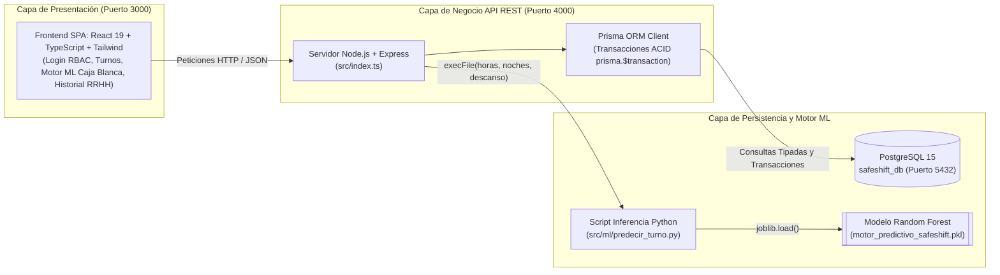

# SafeShift Predictor: Sistema Predictivo de Fatiga y Prevención de Riesgos Laborales

Plataforma web predictiva y transaccional orientada a la prevención activa de accidentes laborales por fatiga extrema, desgaste crónico (*burnout*) y microsueños en el sector de logística, distribución y transporte de carga pesada en Chile.

---

## 1. Descripción del Proyecto

* **¿Qué problema resuelve?:** En la industria logística y de transporte terrestre en Chile, la fatiga laboral suele gestionarse de manera reactiva (después de que ocurre un accidente vial, daño de activos o baja médica) y subjetiva. Además, las empresas enfrentan dificultades para auditar en tiempo real el cumplimiento del **Artículo 38 del Código del Trabajo** sobre jornadas excepcionales y descansos compensatorios.
* **¿Qué hace la solución?:** **SafeShift Predictor** transforma la gestión de turnos en un modelo preventivo e inteligente sin requerir hardware biométrico invasivo en cabina. El sistema integra:
  1. Un **Generador de Datos Sintéticos** en Python (`src/ml/generar_datos_laborales.py`) que emula patrones estadísticos reales de fatiga cumpliendo con la **Ley N° 19.628** sobre Protección de la Vida Privada (`datos_trabajadores.csv` con 1.000 registros).
  2. Un **Motor Predictivo de Machine Learning** (`RandomForestClassifier` serializado en `src/ml/motor_predictivo_safeshift.pkl` y consumido vía `src/ml/predecir_turno.py`) con explicabilidad de **Caja Blanca**, que evalúa horas semanales acumuladas, turnos nocturnos consecutivos y horas de descanso previo para clasificar el riesgo en **NORMAL (<50%)**, **ALERTA (50%–79%)** o **CRÍTICO (>=80%)**.
  3. Un **Dashboard Web Transaccional** que permite ejecutar bloqueos preventivos, asignar sustitutos disponibles de bajo riesgo en tiempo real mediante transacciones ACID (`prisma.$transaction`) en PostgreSQL, simular inferencias en vivo e ingerir lotes de turnos por CSV.
* **¿A quién va dirigido (Usuarios y Stakeholders)?:**
  * **Supervisores de Operaciones / Despacho:** Monitorean el riesgo de las cuadrillas en tiempo real, ingresan turnos y ejecutan reasignaciones preventivas vinculantes sobre la base de datos.
  * **Prevencionistas de Riesgos y Analistas de RRHH:** Auditan la bitácora transaccional de bloqueos y descansos compensatorios (Art. 38) y analizan métricas de reducción de siniestralidad.
  * **Administradores de TI:** Gestionan el control de acceso basado en roles (RBAC), la base de datos y el despliegue en contenedores Docker.

---

## 2. Tecnologías Utilizadas (Stack Tecnológico)

* **Frontend (Capa de Presentación — Puerto `3000`):** React 19, TypeScript, Vite, Tailwind CSS, Lucide Icons.
* **Backend (Capa Lógica y Transaccional — Puerto `4000`):** Node.js, Express, TypeScript, CORS, integración de procesos Python vía `node:child_process`.
* **Base de Datos y ORM (Capa de Persistencia — Puerto `5432`):** PostgreSQL 15 (`safeshift_db`) y **Prisma ORM** (migraciones declarativas, tipado estricto y transacciones ACID).
* **Ciencia de Datos y Machine Learning:** Python 3, Scikit-Learn (`RandomForestClassifier`), Pandas, NumPy, Joblib, Jupyter Notebook (`entrenamiento_modelo.ipynb`).
* **Infraestructura, DevOps y Control de Versiones:** Docker, Docker Compose (`Dockerfile`, `frontend/Dockerfile`, `docker-compose.yml`), Git y GitHub.

---

## 3. Integrantes del Equipo y Roles

| Integrante | RUT | Rol en el Proyecto | Responsabilidades Principales |
| :--- | :--- | :--- | :--- |
| **Ignacio Cuevas** | 21.703.347-0 | **Ingeniero Backend, Arquitectura de Datos & DevOps** | Diseño e implementación del esquema relacional en Prisma ORM / PostgreSQL, desarrollo de la API REST transaccional, conexión con el modelo `.pkl` y contenerización Docker. |
| **Benjamín Berrios** | 21.683.327-9 | **Analista de Gestión de Personas, Reglas de Negocio & Documentación** | Definición de reglas normativas (Art. 38 Código del Trabajo y Ley 19.628), diseño arquitectónico, diagramas DER/UML, gestión de *Daily Scrum* e informes técnicos. |
| **Javiera Vargas** | 21.369.093-0 | **Ingeniera de Machine Learning, Datos Sintéticos & QA** | Desarrollo del generador de datos sintéticos (`generar_datos_laborales.py`), entrenamiento/calibración del motor predictivo (`predecir_turno.py`) y ejecución del Plan de Pruebas QA. |
| **Matías Carrasco** | 20.247.894-8 | **Ingeniero Frontend & Integración UI/UX** | Construcción del Dashboard interactivo en React + TypeScript, control de acceso por roles (Login RBAC), simulador visual de Caja Blanca ML, módulo de ingesta CSV y modales transaccionales. |

---

## 4. Metodología de Trabajo

El equipo aplica una **Metodología Híbrida** adaptada a proyectos que combinan ingeniería de software transaccional con ciencia de datos:
1. **CRISP-DM (Cross-Industry Standard Process for Data Mining):** Guía el ciclo de vida del motor predictivo (Comprensión del Negocio y Normativa Laboral, Generación y Preparación del Dataset Sintético, Modelado del Clasificador *Random Forest*, Evaluación de Precisión >80% y Despliegue en Producción).
2. **Marco Ágil Scrum / Kanban:** El desarrollo incremental de la plataforma se organiza en Sprints, respaldado por historias de usuario priorizadas (*Product Backlog*), criterios de aceptación (*Definition of Done*), control de versiones colaborativo en GitHub y seguimiento periódico documentado en `Fase 2/Daily_Scrum_SafeShift_Predictor.xlsx`.

---

## 5. Arquitectura de la Solución y Modelo de Datos

El sistema implementa una arquitectura **N-Tier desacoplada en 3 capas** y orquestada con Docker:

## 6. Instrucciones para Ejecución Local
*(Nota: Estas instrucciones se irán actualizando durante la Fase 2 del desarrollo).*
1. Clonar este repositorio: `git clone https://github.com/tu-usuario/safeshift-predictor.git`
2. Instalar Docker Desktop en la máquina local.
3. Ejecutar el comando de orquestación (por definir): `docker-compose up -d`
4. Acceder al dashboard en `http://localhost:3000`
